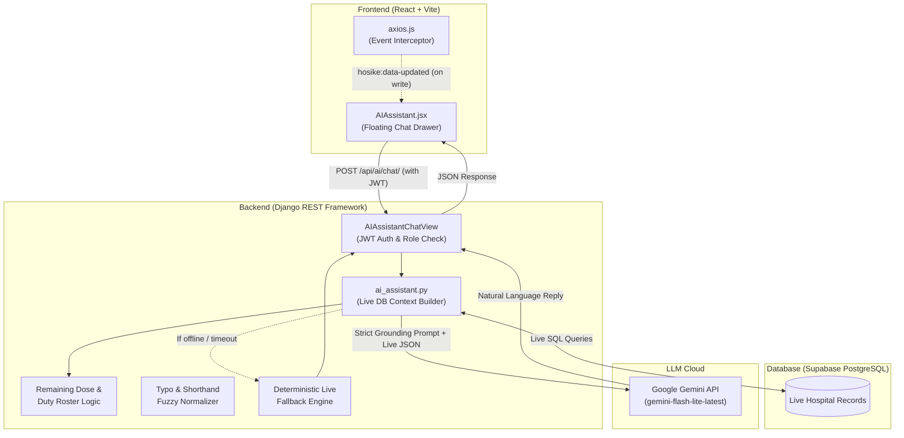

# HosiKe AI Assistant — Architecture & Implementation Guide

> Complete technical and operational guide to the HosiKe AI Assistant: how it works, its live-data architecture, API flow, security design, and how to configure it.

---

## 1. Executive Summary: What is "Live-RAG"?

Traditional AI assistants (like standalone ChatGPT) have **zero knowledge** of a hospital's internal database. If you ask ChatGPT *"When is my next appointment?"*, it has no way of knowing.

Training or fine-tuning an AI model on a hospital database is also not practical because:
1. Hospital data changes every second (new appointments, vitals, prescriptions).
2. Retraining takes hours or days and costs money.
3. Models can hallucinate (make up facts).

Instead, **HosiKe AI** uses **Live Retrieval-Augmented Generation (Live-RAG)**:

> **Whenever a user asks a question, the Django backend first inspects the live Supabase PostgreSQL database, collects only the records that user is authorized to see, packages them into a live JSON snapshot, and gives that snapshot to Google Gemini as a strict cheat-sheet.**

Gemini converts that exact database snapshot into a warm, natural, human conversation—meaning **it never hallucinates** and **is always 100% up to date**.

---

## 2. System Architecture Diagram



---

## 3. Step-by-Step Request Lifecycle

Here is the exact journey of a message from your keyboard to the AI response:

### Step 1: User Sends a Message
- In the React frontend, the user types a question in [AIAssistant.jsx](frontend/src/components/AIAssistant.jsx) (e.g. *"how mny dctors do we have and who is on duty?"*).
- React makes an authenticated request:
  ```http
  POST /api/ai/chat/
  Authorization: Bearer <JWT_ACCESS_TOKEN>
  Content-Type: application/json

  {
    "message": "how mny dctors do we have and who is on duty?",
    "history": [...]
  }
  ```

### Step 2: Role-Based Access Control (RBAC) & Privacy
- In [views.py](backend/api/views.py), `AIAssistantChatView` verifies the JWT token and identifies `request.user.role`:
  - **Patient:** The engine queries **only that specific patient's** prescriptions, appointments, vitals, doctor feedback, and admission info.
  - **Doctor:** The engine queries that doctor's schedule, assigned patients, pending approvals, and vitals awaiting review.
  - **Nurse:** The engine queries the nursing triage queue, pending tasks, unadministered prescriptions, and inpatient medication schedules.
  - **Admin:** The engine queries hospital-wide KPIs, all staff on duty, unassigned appointments, and audit activity.
- **Privacy Guarantee:** A patient can never access or query another patient's medical records.

### Step 3: Live Snapshot Extraction
- [ai_assistant.py](backend/api/ai_assistant.py) executes optimized Django ORM queries with `select_related`, `prefetch_related`, and `aggregate`.
- It executes domain-specific algorithms:
  - **Remaining Dose Calculator:** Computes daily time slots (`Morning`, `Afternoon`, `Evening`), checks whether the current hour has passed the slot, inspects `administered` status, and multiplies remaining days by daily frequency.
  - **Duty Roster Inspector:** Reads `DoctorProfile.is_on_duty` and `NurseProfile.is_on_duty` directly from the database.
- The result is a clean Python dictionary (`LIVE_CONTEXT`).

### Step 4: Strict Prompt Construction & Gemini API Call
- The backend wraps the live data into a strict prompt:
  ```text
  You are HosiKe AI, a warm, intelligent hospital assistant for a {role} user.
  Respond naturally to human conversation, greetings, small talk, and typos.
  For any hospital facts, counts, prescriptions, doses, vitals, or dates, 
  answer ONLY from the live database JSON below.
  Never invent medical records. If data is empty, say so.

  LIVE_CONTEXT:
  { ...live database json... }
  ```
- It sends this prompt + conversation history to:
  `https://generativelanguage.googleapis.com/v1beta/models/gemini-flash-lite-latest:generateContent?key=GEMINI_API_KEY`

### Step 5: Rendering & Live UI Update
- Gemini analyzes the live JSON and the user's question, formulating an accurate, natural response.
- The frontend renders the Markdown text (with bold text, bullet points, and code tags) and updates the top live summary chips (`Active Rx`, `Doses Left`, `Today Appts`, etc.).

---

## 4. How the AI Updates Itself in Real Time

| Mechanism | How It Works | Why It Matters |
|---|---|---|
| **Zero Caching** | Every query runs fresh against the database. | If a doctor writes a prescription at 10:00, the patient's AI sees it at 10:01. |
| **Event-Driven Auto-Sync** | [axios.js](frontend/src/api/axios.js) intercepts every successful `POST`, `PUT`, `PATCH`, or `DELETE` API call and dispatches a browser event: `hosike:data-updated`. | Whenever the user books an appointment or staff logs vitals, the AI summary chips refresh immediately without reloading the page. |
| **20-Second Polling** | While the AI chat drawer is open, it automatically polls `/api/ai/context/` every 20 seconds. | Live updates made by other staff on other computers appear automatically. |

---

## 5. Built-in Safety & Fallback Architecture

What happens if the internet goes down, or if the Gemini API is unreachable?

The system includes a **Two-Tier Fallback Mechanism**:

1. **Tier 1 (Advanced Cloud LLMs):**
   - Checks `GEMINI_API_KEY` (Gemini Flash Lite)
   - Checks `GROQ_API_KEY` (Groq Llama 3.3 70B)
   - Checks `OPENAI_API_KEY` (OpenAI GPT-4o-mini)
   - Checks `OLLAMA_MODEL` (Local offline Ollama)
2. **Tier 2 (Built-in Fuzzy NLP Engine):**
   - If no external LLM is configured or if an API call times out, the assistant **does not crash**.
   - It seamlessly runs `_format_patient_reply` or `_format_staff_reply` locally using:
     - **Shorthand expansion:** `mny → many`, `dctors → doctors`, `rx → prescriptions`, `gm → good morning`
     - **Fuzzy matching:** `difflib.get_close_matches` with a 0.72 similarity cutoff for typos
     - **Time-aware greetings:** Automatically greets with *"Good morning"*, *"Good afternoon"*, or *"Good evening"* based on Kenyan local time (`Africa/Nairobi`).

---

## 6. Configuration & Environment Variables

All settings are managed via `backend/.env` (which is kept out of version control via `.gitignore`):

```ini
# Supabase PostgreSQL Database
DATABASE_URL=postgresql://postgres.<ref>:<password>@aws-1-eu-west-1.pooler.supabase.com:6543/postgres?pgbouncer=true
DIRECT_URL=postgresql://postgres.<ref>:<password>@aws-1-eu-west-1.pooler.supabase.com:5432/postgres

# Google Gemini API
GEMINI_API_KEY=your-gemini-api-key
GEMINI_MODEL=gemini-flash-lite-latest

# Optional Alternative LLM Providers (if you ever want to switch)
# GROQ_API_KEY=gsk_...
# GROQ_MODEL=llama-3.3-70b-versatile
# OPENAI_API_KEY=sk-...
# OPENAI_MODEL=gpt-4o-mini
# OLLAMA_MODEL=llama3.2
```

---

## 7. File Map & Code Locations

- **[backend/api/ai_assistant.py](backend/api/ai_assistant.py):** The complete AI engine — context retrieval, dose math, multi-LLM integration, and fuzzy NLP fallback.
- **[backend/api/views.py](backend/api/views.py):** Endpoints `AIAssistantChatView` (`/api/ai/chat/`) and `AIAssistantContextView` (`/api/ai/context/`).
- **[backend/api/urls.py](backend/api/urls.py):** URL routing for the AI endpoints.
- **[frontend/src/components/AIAssistant.jsx](frontend/src/components/AIAssistant.jsx):** The interactive chat widget, live chips, suggestion pills, and real-time state listeners.
- **[frontend/src/components/Layout.jsx](frontend/src/components/Layout.jsx):** Integrates the AI button into the global top bar and floating action trigger.
- **[frontend/src/api/axios.js](frontend/src/api/axios.js):** Intercepts mutations and triggers `hosike:data-updated` to keep the AI continuously synchronized.
